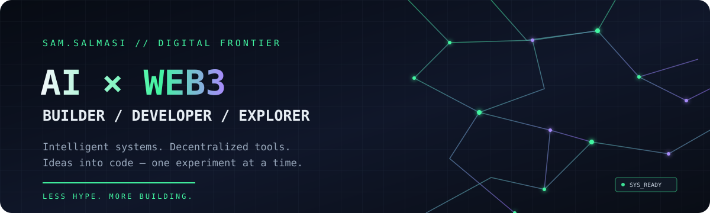

  
  

`AI AGENTS` &nbsp;·&nbsp; `WEB3` &nbsp;·&nbsp; `CRYPTO TOOLS` &nbsp;·&nbsp; `AUTOMATION`

---

## `> whoami`

I'm **Sam Salmasi** — a developer exploring the intersection of **AI, Web3, and crypto**.

I like turning ideas into working experiments, learning by building, and creating tools that are useful beyond the hype.

- 🧠 Exploring AI-powered tools and agent workflows
- ⛓️ Interested in blockchain ecosystems and crypto infrastructure
- 🛠️ Building with Python, JavaScript, HTML, CSS, and PHP
- 🌱 Learning in public and growing through open-source work

## `> tech_stack`

  
  
  
  
  

**Areas I'm exploring:** AI agents · Web3 applications · crypto analytics · automation · developer tools

> AI and Web3 are my focus areas, not programming languages. The stack above lists technologies I've said I use; I'll add frameworks and tools as I confirm them.

## `> current_missions`

| Mission | Objective |
|---|---|
| `01 / AI AGENTS` | Experiment with AI-powered workflows and useful assistants |
| `02 / WEB3 TOOLS` | Explore practical tools for decentralized ecosystems |
| `03 / CRYPTO INTELLIGENCE` | Investigate ways to make public crypto data easier to understand |
| `04 / OPEN SOURCE` | Ship experiments, document them, and improve through feedback |

## `> connect`

- **GitHub:** [@SamSalmasi](https://github.com/SamSalmasi)
- **X:** [@SalmasiSam16459](https://x.com/SalmasiSam16459)

---

`THINK IN SYSTEMS` &nbsp; `BUILD IN PUBLIC` &nbsp; `SHIP USEFUL THINGS`

Less hype. More building. ◈

